<div align="center">

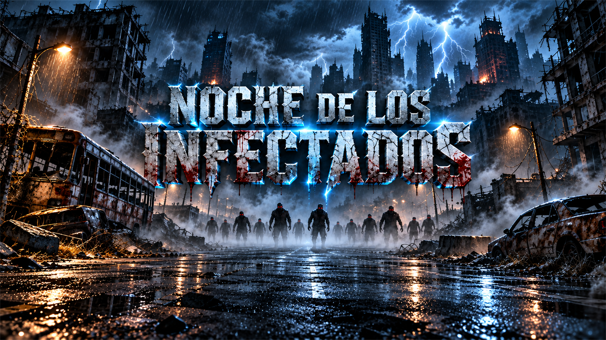

# Noche de los Infectados


**Sobrevive a la noche. Dispara. Recuerda.**

Un videojuego de supervivencia zombie con oleadas, combate directo, cartas de mejora, clima dinámico, selección de personajes y un bestiario que se completa al derrotar a los infectados.

[Características](#características) · [Gameplay](#galería) · [Instalación](#cómo-ejecutar) · [Roadmap](#roadmap)

</div>

> [!NOTE]
> El proyecto se encuentra en desarrollo activo. Las imágenes y GIFs que todavía no existan están señalizados como marcadores de posición para facilitar futuras capturas.

## Índice

- [Descripción](#descripción)
- [Características](#características)
- [Mecánicas](#mecánicas)
- [Objetos y cartas](#objetos-y-cartas)
- [Galería](#galería)
- [Controles](#controles)
- [Tecnologías](#tecnologías)
- [Estructura](#estructura-del-proyecto)
- [Cómo ejecutar](#cómo-ejecutar)
- [Exportación](#exportación)
- [Configuración climática](#configuración-climática)
- [Roadmap](#roadmap)
- [Créditos](#créditos)
- [Licencia](#licencia)

## Descripción

**Noche de los Infectados** es una experiencia de supervivencia arcade ambientada en una ciudad devastada por una epidemia. El jugador elige un superviviente, recorre un escenario urbano contaminado y resiste oleadas cada vez más peligrosas mientras toma decisiones de construcción mediante cartas.

La partida combina acción inmediata con progresión estratégica:

- Entra en combate y dispara con precisión.
- Controla el espacio usando la carretera y los obstáculos del mapa.
- Elige mejoras con rarezas Común, Rara, Épica y Legendaria.
- Adáptate a lluvia, niebla, tormentas y noche.
- Descubre nuevos tipos de zombie únicamente cuando son derrotados.

## Características

| Sistema | Estado | Descripción |
| --- | :---: | --- |
| Selección de personajes | ✅ | Retratos, estadísticas, preview animado y selección exclusiva. |
| Combate | ✅ | Movimiento WASD, apuntado por ratón y proyectiles. |
| Oleadas | ✅ | Zombies que llegan por puntos de aparición situados en la carretera. |
| Cartas de mejora | ✅ | Tres opciones, pausa de partida, rarezas, acumulación y evoluciones. |
| Clima dinámico | ✅ | Configurable mediante `ClimateSettings` y `ClimateManager`. |
| Zonas progresivas | 🟡 | Fondos, navegación, waypoints, rutas de recursos, pools de enemigos, preferencias de loot, dos obstáculos por zona y atlas gráfico v2; faltan pruebas finales. |
| Bestiario | ✅ | El enemigo se desbloquea al morir, no al aparecer. |
| Inspección | ✅ | Doble clic sobre personajes y enemigos para ver estadísticas. |
| Obstáculos | ✅ | Objetos destruibles con vida, daño, colisión y actualización de navegación. |
| Audio | ✅ | `AudioManager` global, bus de mejoras, sonidos por carta/rareza y fallback seguro. |
| Exportación multiplataforma | 🟡 | Windows, Web e iOS configurados; Linux y Android requieren añadir presets. |

### Personajes

Los nombres mostrados al jugador y sus identificadores de guardado están separados para mantener la compatibilidad de las partidas:

| ID interno | Nombre visible | Voz de selección |
| --- | --- | --- |
| `lumberjack` | AlexLuigui | `audio/voces/Alexluigui.ogg` |
| `hunter` | Melo | `audio/voces/Melo.ogg` |
| `engineer` | Cristhian | `audio/voices/Cristhian.ogg` |
| `survivor` | Loba Herida | `audio/voices/Lobaherida.ogg` |

Las voces se reproducen al pasar el cursor, cambiar el foco con teclado/gamepad o seleccionar mediante controles táctiles. El sistema reutiliza un solo reproductor para evitar solapamientos.

## Mecánicas

### Combate

El jugador se mueve por el mapa urbano, apunta con el ratón y dispara proyectiles. Las balas interactúan con zombies y obstáculos. Los objetos destruibles pueden recibir daño, cambiar de estado visual y liberar rutas o recompensas.

### Sistema de oleadas

Los infectados no aparecen delante del jugador de forma aleatoria. Cada oleada utiliza puntos de aparición ubicados en la parte superior de la carretera y una serie de waypoints para que los zombies entren desde el horizonte de la ciudad.

- Oleadas progresivas con mayor cantidad de enemigos.
- Aparición coordinada por la carretera principal.
- Navegación mediante `NavigationAgent2D`.
- Rutas alrededor de coches, árboles, autobuses y barricadas.
- Dificultad creciente basada en el número de oleada.

### Cartas de mejora

Cada cierto tiempo la partida se detiene y aparecen tres cartas. La elección se aplica inmediatamente.

Mejoras disponibles:

- **Furia** — aumenta los puntos obtenidos por zombie.
- **Paso Ligero** — aumenta la velocidad de movimiento.
- **Botiquín** — recupera vidas hasta el límite permitido.
- **Balas Pesadas** — mejora los proyectiles y la cadencia.
- **Loba Herida** — proporciona protección temporal.

Rarezas:

- **Común** — Rango I.
- **Rara** — Rango II.
- **Épica** — Rango III.
- **Legendaria** — Rango IV.

Las mejoras se acumulan con límites para preservar el equilibrio. Al maximizar una mejora puede desbloquearse una evolución especial, como **Furia Sangrienta**, **Corredor Fantasma** o **Munición Devastadora**.

La interfaz incluye entrada animada, hover, brillo, partículas, expansión de la carta elegida, flash legendario y audio centralizado.

### Objetos y cartas

#### Objetos del suelo

Los objetos aparecen dinámicamente en la ruta jugable. Al recogerlos, el aviso sobre el personaje muestra la cantidad y el efecto aplicado. Los objetos de inventario se guardan con la partida; no son buffs temporales.

| Objeto | Gráfico | Recompensa / efecto | Duración |
| --- | :---: | --- | --- |
| Munición | 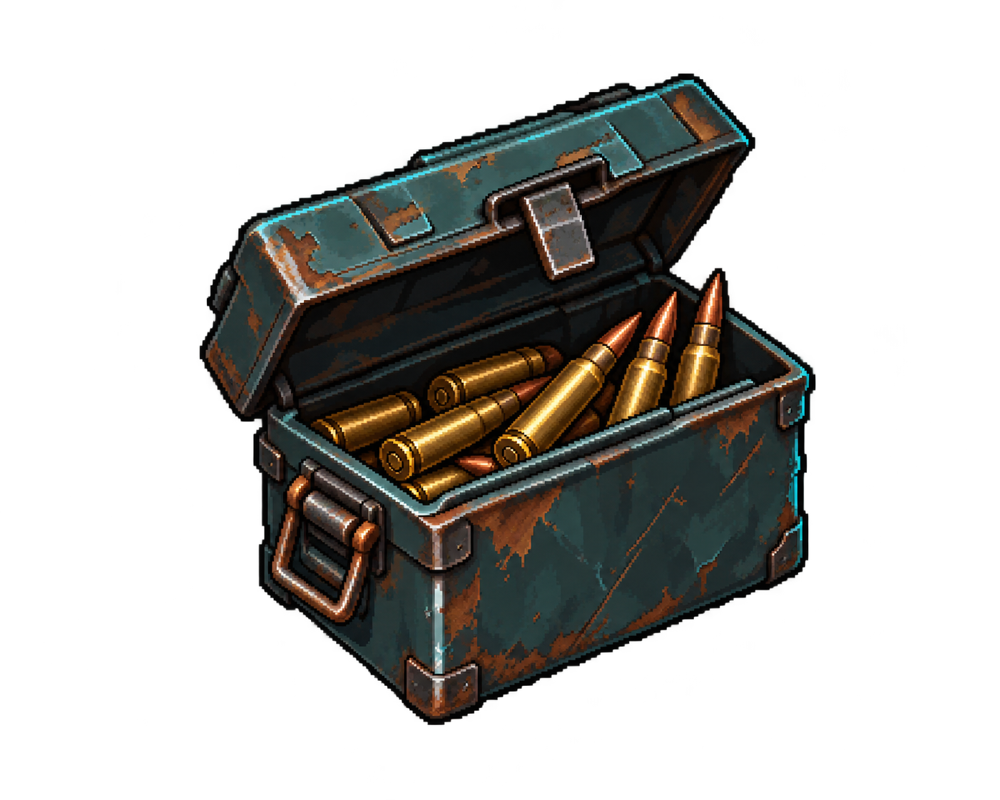 | Añade munición a la reserva. El jugador comienza con un cargador `25/25`; `R` recarga usando la reserva. | Instantáneo; la reserva se conserva |
| Botiquín | 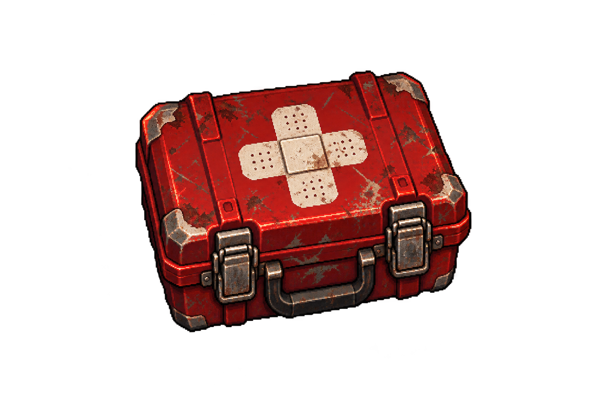 | Recupera `+1` corazón y, si ya estabas al máximo, aumenta también el máximo acumulable. Límite: `12` corazones. | Instantáneo; los corazones se conservan |
| Chatarra | 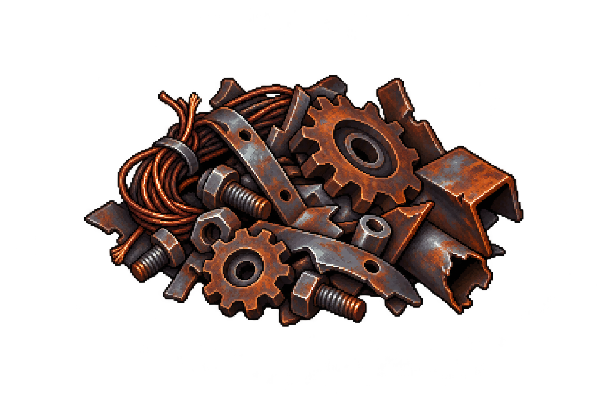 | Añade `+1` unidad al inventario para recursos y fabricación futura. | Permanece en la partida guardada |
| Materiales | 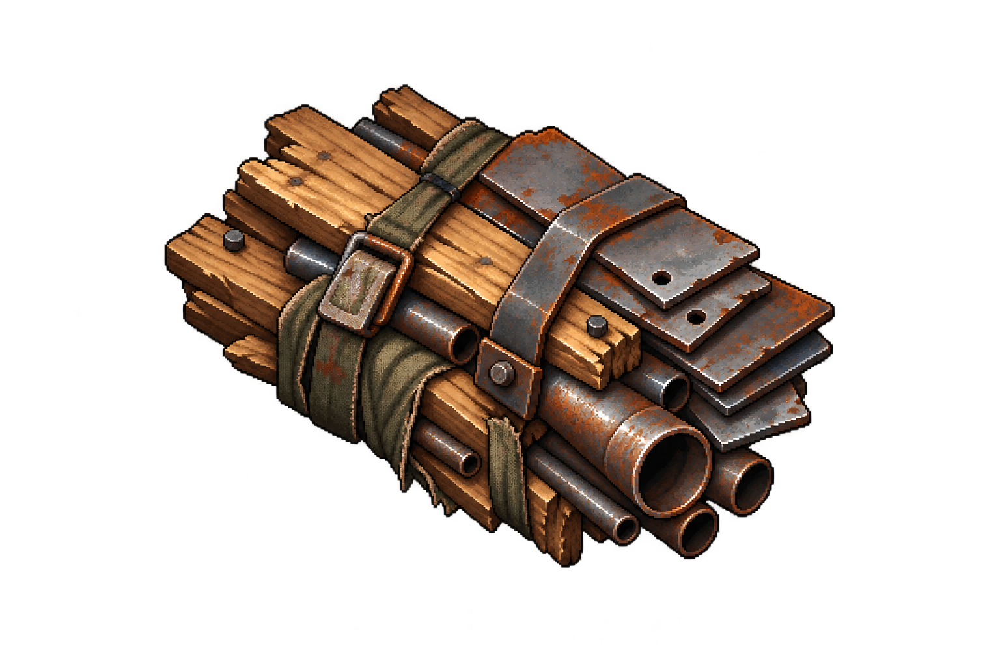 | Añade `+1` unidad al inventario. | Permanece en la partida guardada |
| Comida | 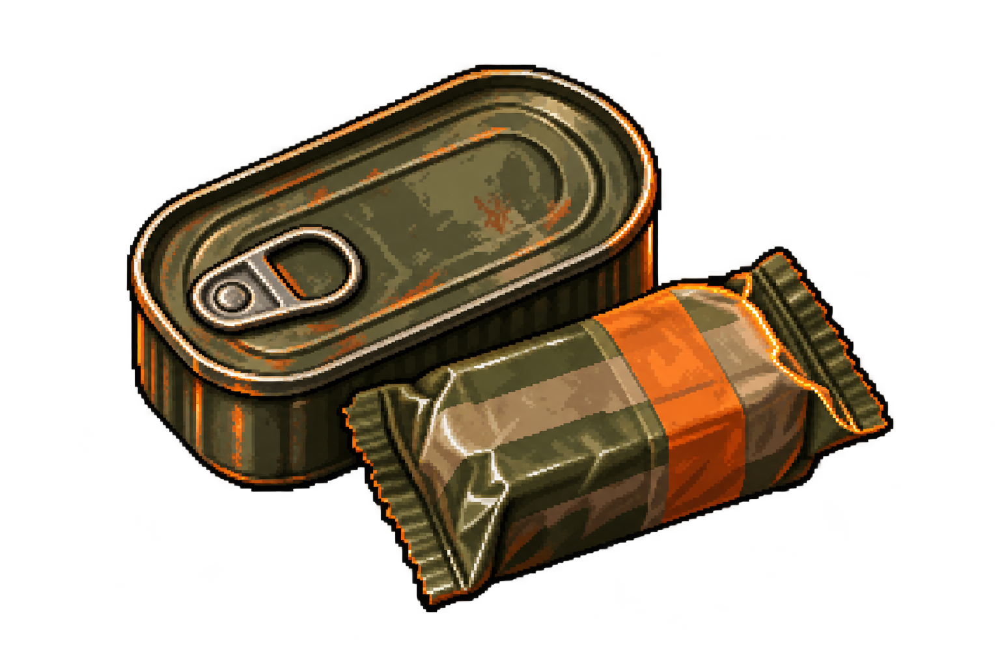 | Añade `+1` unidad y concede `+25` puntos. | Puntos instantáneos; unidad guardada |
| Agua | 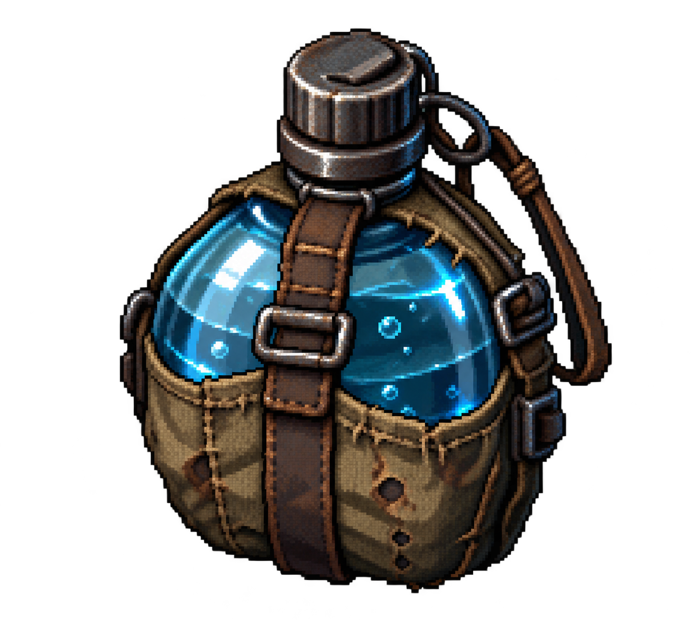 | Añade `+1` unidad al inventario para supervivencia y sistemas futuros. | Permanece en la partida guardada |

#### Cartas de mejora

Las cartas se acumulan por rangos. Salvo que se indique lo contrario, sus mejoras son permanentes durante la partida y se conservan al cambiar de zona.

| Carta | Gráfico | Efecto | Duración |
| --- | :---: | --- | --- |
| Furia | 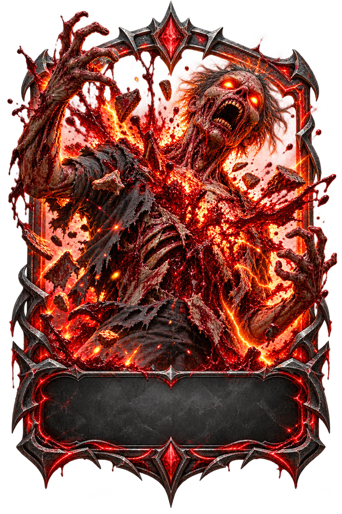 | Aumenta los puntos por zombie: `+15%` Común, `+25%` Rara, `+40%` Épica, `+75%` Legendaria. | Permanente |
| Paso Ligero | 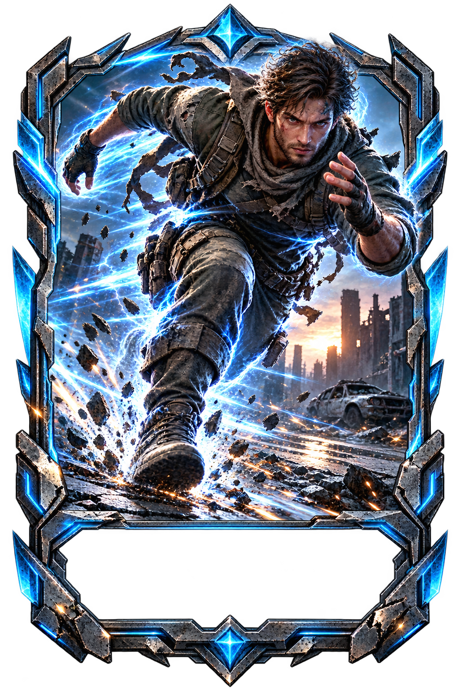 | Aumenta la velocidad: `+10%`, `+18%`, `+30%` o `+50%` según rareza. La Legendaria añade Corredor Fantasma. | Velocidad permanente; intangibilidad Legendaria: `2 s` |
| Botiquín | 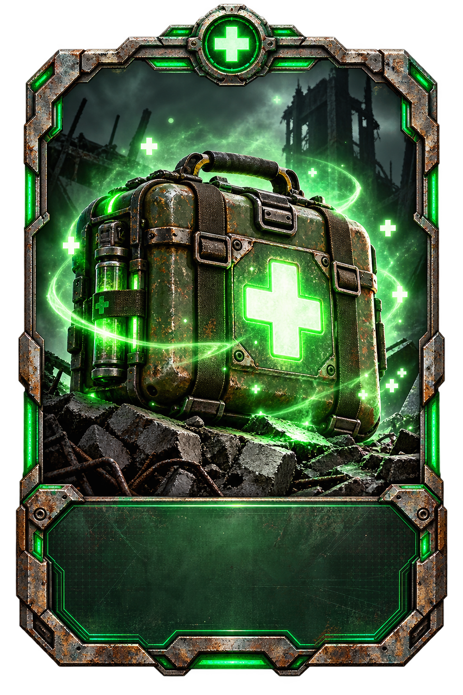 | Recupera `+1`, `+1`, `+2` o `+3` vidas según rareza, sin superar `3`. | Instantáneo |
| Balas Pesadas | 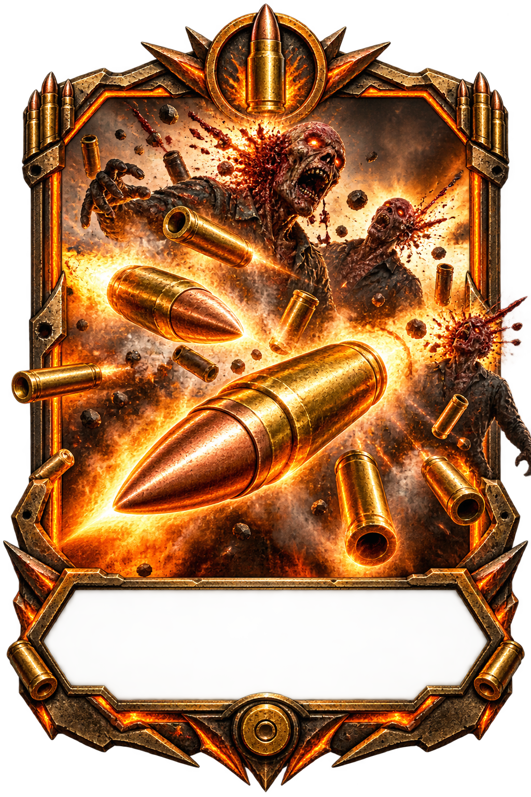 | Mejora la velocidad de bala: `+15%`, `+30%` o `+50%`. La Legendaria añade `+75%` de cadencia y proyectiles grandes. | Permanente |
| Loba Herida | 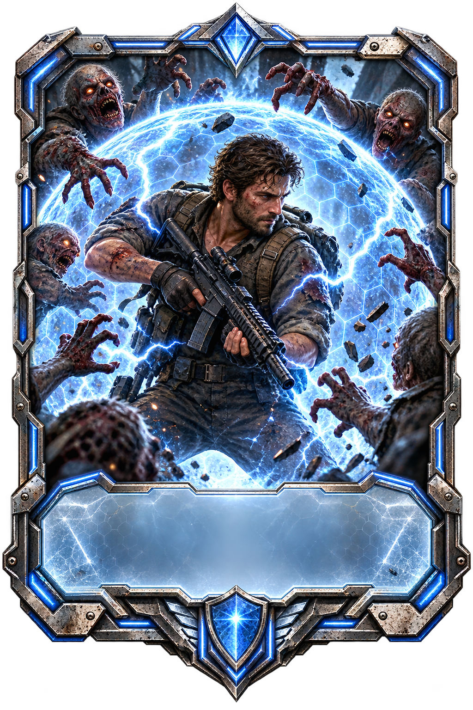 | Concede invulnerabilidad temporal. | Común `1,5 s` · Rara `3 s` · Épica `5 s` · Legendaria `8 s` |

Los iconos de buff aparecen sobre el jugador mientras el efecto está activo. Los efectos temporales muestran una cuenta atrás; los permanentes permanecen hasta iniciar una nueva partida o reiniciar su progreso.

### Clima dinámico y ciclo día/noche

El clima tiene efectos de gameplay, no solo visuales:

- **Soleado** — visibilidad máxima.
- **Nublado** — ambiente más oscuro y menor visibilidad.
- **Lluvia** — reduce un 5% la velocidad del jugador y de los zombies; añade lluvia y charcos.
- **Tormenta** — relámpagos, oscurecimiento, flashes y truenos.
- **Niebla** — reduce la distancia de visión y adelanta los puntos de entrada de los enemigos.
- **Noche** — oscurece el mapa y fortalece a los infectados.

La noche aplica una bonificación configurable por categoría de enemigo: básica, corredor, infectado y élite/jefe.

Las configuraciones están disponibles en:

```text
resources/climate/ClimateSettings_Facil.tres
resources/climate/ClimateSettings_Normal.tres
resources/climate/ClimateSettings_Dificil.tres
resources/climate/ClimateSettings_Pesadilla.tres
```

### Bestiario

El bestiario registra enemigos cuando mueren. Incluye datos como nombre, nivel, vida, ataque, defensa, velocidad, habilidades, descripción, tipo y experiencia otorgada.

### Zonas y progresión

La partida avanza por siete zonas conectadas mediante salidas físicas:

`Bosque → Carretera abandonada → Gasolinera → Pueblo → Hospital → Zona industrial → Base militar`

Cada zona dispone de una escena de configuración en `scenes/world/zones/` con fondo gráfico, límites navegables propios, puntos de aparición, waypoints de enemigos, rutas de recursos, clima inicial, pool de enemigos, preferencias de loot, dos obstáculos gráficos configurables y multiplicador de dificultad. `ResourceSpawner` combina las preferencias de zona con los modificadores meteorológicos sin superar los límites globales.

Antes de las pruebas jugables se puede ejecutar `tools/validate_zones.gd` en modo headless; verifica las siete escenas, recursos gráficos, pools, rutas y configuración navegable.

Las salidas se desbloquean al completar las oleadas 5, 10, 15, 20 y 25. El cambio conserva recursos, mejoras, evoluciones y progreso guardado.

## Galería

### Menú principal

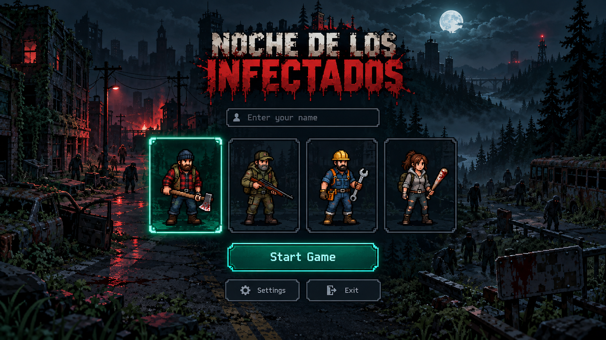

### Capturas

> [!TIP]
> Coloca las capturas reales en `docs/images/` usando los nombres indicados abajo.

<!-- Añadir: docs/images/gameplay.png -->
<!--  -->

<!-- Añadir: docs/images/menu.png -->
<!--  -->

<!-- Añadir: docs/images/bestiario.png -->
<!--  -->

### Gameplay

<!-- Añadir: docs/gifs/gameplay.gif -->
<!--  -->

### Sistema de combate

<!-- Añadir: docs/gifs/combate.gif -->
<!--  -->

### Sistema de oleadas

<!-- Añadir: docs/gifs/oleadas.gif -->
<!--  -->

### Sistema de cartas

<!-- Añadir: docs/images/cartas.png -->
<!--  -->

### Clima dinámico

<!-- Añadir: docs/gifs/clima.gif -->
<!--  -->

### Bestiario

<!-- Añadir: docs/images/bestiario.png -->
<!--  -->

## Controles

| Acción | Tecla / entrada |
| --- | --- |
| Mover arriba | `W` / D-pad arriba |
| Mover abajo | `S` / D-pad abajo |
| Mover izquierda | `A` / D-pad izquierda |
| Mover derecha | `D` / D-pad derecha |
| Disparar | Clic izquierdo |
| Inspeccionar | Doble clic sobre un personaje o enemigo |
| Reintentar tras morir | `R` |
| Menús | Ratón |

## Tecnologías

- **Godot Engine 4.7**.
- **GDScript**.
- Renderizado **Compatibility / OpenGL**.
- `CharacterData` y `EnemyData` como recursos configurables.
- `NavigationRegion2D` y `NavigationAgent2D`.
- `ParallaxBackground` y `ParallaxLayer`.
- `TileMapLayer` para la estructura urbana.
- `AudioStreamPlayer` y `AudioStreamGenerator`.
- Autoload global `AudioManager`.
- Recursos `.tres` para personajes, clima y datos de juego.

## Estructura del proyecto

```text
.
├── assets/
│   ├── backgrounds/       # Fondos del menú y ciudad
│   ├── characters/        # Sprites y animaciones de supervivientes
│   ├── ui/                # Interfaz y cartas de mejora
│   ├── world/             # Tileset y backdrop urbano
│   └── zombies/           # Sprites de infectados
├── audio/
│   ├── cards/             # Aparición, hover, selección y fallback
│   ├── upgrades/          # Sonidos específicos de mejoras
│   ├── rarity/            # Sonidos por rareza
│   └── voces/             # Voces de selección de personajes
├── docs/
│   ├── images/            # Capturas, banner y arte promocional
│   ├── gifs/              # GIFs de gameplay y sistemas
│   └── videos/            # Vídeos o enlaces de tráiler
├── resources/
│   ├── characters/        # CharacterData de supervivientes
│   └── climate/           # Presets ClimateSettings
├── scenes/
│   ├── enemies/           # Escenas de zombies
│   └── ui/                # Bestiario e inspección
├── scripts/
│   ├── AudioManager.gd
│   ├── characters/
│   ├── enemies/
│   ├── ui/
│   └── world/
├── main.gd
├── main.tscn
├── project.godot
└── export_presets.cfg
```

## Cómo ejecutar

### Desde el editor

1. Instala Godot **4.7.x**.
2. Importa la carpeta del proyecto.
3. Abre `main.tscn` o pulsa **Play Project**.

### Desde terminal

```bash
godot --editor --path .
godot --path .
```

En Windows también se puede utilizar el ejecutable instalado de Godot:

```powershell
godot.windows.opt.tools.64.exe --path .
```

## Exportación

Antes de exportar, instala las plantillas correspondientes desde **Editor → Manage Export Templates**.

### Windows

El preset `Windows Desktop` ya está incluido:

```bash
godot --headless --path . --export-release "Windows Desktop" build/NocheDeLosInfectados.exe
```

### Linux

Añade primero un preset **Linux/X11** en Godot:

```bash
godot --headless --path . --export-release "Linux/X11" build/NocheDeLosInfectados.x86_64
chmod +x build/NocheDeLosInfectados.x86_64
```

### Android

Configura el SDK, JDK, keystore y un preset **Android** en Godot:

```bash
godot --headless --path . --export-debug "Android" build/NocheDeLosInfectados.apk
```

> [!IMPORTANT]
> El archivo `export_presets.cfg` incluido actualmente contiene presets para Windows, iOS y Web. Linux y Android necesitan ser añadidos desde el editor antes de ejecutar sus comandos de exportación.

### Web

También existe un preset Web:

```bash
godot --headless --path . --export-release "Web" build/web/index.html
```

Para probar una exportación Web localmente, sirve la carpeta con un servidor HTTP. No abras el `.html` directamente desde `file://`.

## Configuración climática

Selecciona el nodo `ClimateManager` en `main.tscn` y cambia `Settings` desde el Inspector.

Los presets incluyen:

| Preset | Intensidad | Uso recomendado |
| --- | --- | --- |
| Fácil | Baja | Primera partida y pruebas de sistemas. |
| Normal | Equilibrada | Experiencia base. |
| Difícil | Alta | Oleadas avanzadas. |
| Pesadilla | Muy alta | Desafío extremo. |

Los campos exportados incluyen duración del día/noche, probabilidades de lluvia, niebla y tormenta, intensidad visual, frecuencia de rayos, bonificación nocturna y velocidad de transición.

## Roadmap

- [x] Selección de personajes y estadísticas.
- [x] Combate básico y oleadas por carretera.
- [x] Cartas de mejora con rarezas y acumulación.
- [x] Evoluciones de mejoras.
- [x] Bestiario desbloqueado al derrotar enemigos.
- [x] Clima configurable con presets.
- [x] AudioManager y fallback seguro.
- [ ] Añadir capturas y GIFs finales de cada sistema.
- [ ] Completar presets Linux y Android.
- [ ] Añadir música dinámica y voces de mejoras legendarias.
- [ ] Más mapas urbanos y escenarios temáticos.
- [ ] Jefes de oleada y eventos de ciudad.
- [ ] Guardado de progreso y estadísticas persistentes de campaña.
- [ ] Pulido final para Steam, itch.io y dispositivos móviles.

## Créditos

Proyecto: **Noche de los Infectados**  
Motor: **Godot Engine 4.7**  
Desarrollo: equipo del proyecto Noche de los Infectados  
Arte generado y adaptado para uso en el proyecto.  
Efectos de audio generados localmente y organizados por `AudioManager`.

## Licencia

Actualmente el repositorio no incluye un archivo `LICENSE`. Hasta que se defina una licencia explícita, todos los derechos sobre el código, los recursos visuales, el audio y la marca **Noche de los Infectados** quedan reservados.

Antes de publicar una copia pública o aceptar contribuciones externas, añade una licencia oficial —por ejemplo MIT para el código y una licencia separada para los recursos artísticos— y actualiza esta sección.

---

<div align="center">

**Noche de los Infectados** · Sobrevive a la noche.

</div>
